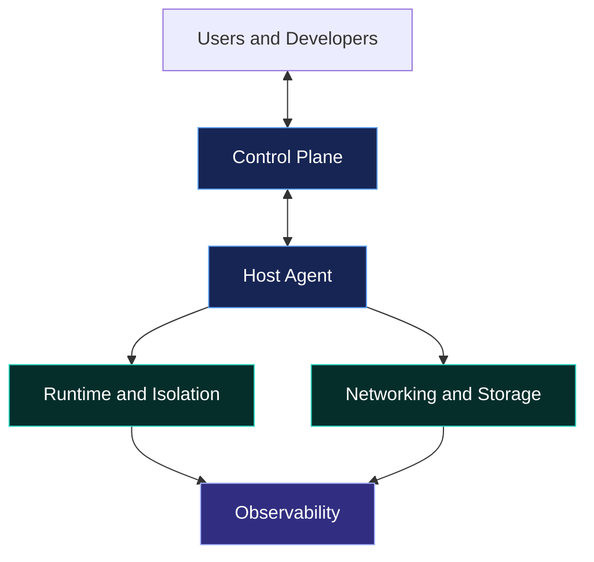

# Hi, I'm Jana 👋

### Actively building · Systems Engineer · Fractional CTO

  

> "I was interested in doing it, there was an opportunity, so I just did it." — Barbara Liskov

**AGI, one linear layer at a time.**

Systems engineer and fractional CTO based in Madurai, India. I build infrastructure, developer tools, and systems software with a focus on simplicity, security, performance, and long-term maintainability.

Building **[BlackLoverTech](https://github.com/blacklovertech)** — technology that builds, understands, and protects systems.

  
  
  
  

---

## Infrastructure from First Principles

I believe good engineering starts with understanding the problem, choosing the right abstractions, and keeping the implementation as simple as possible.

I build from first principles when it provides meaningful control or insight. I reuse proven solutions when they already solve the problem well.

**Build from first principles. Reuse what works. Own what matters.**

## Engineering Principles

- **Open source first.** Prefer transparent, auditable software and open standards.
- **Simplicity over complexity.** Build the smallest architecture that solves the problem well.
- **Proven over fashionable.** Choose mature tools and validated approaches over novelty without evidence.
- **Understand the stack.** Learn how systems work beneath their abstractions.
- **Own the critical path.** Implement core components when control, security, or performance justifies the cost.
- **Minimal dependencies.** Prefer compact systems, predictable deployments, and standalone binaries.
- **AI-friendly architecture.** Keep codebases consistent and easy for humans and AI tools to understand.
- **Measure before optimizing.** Use profiling, benchmarks, and repeatable tests.
- **Security by design.** Minimize attack surfaces and define clear trust boundaries.
- **Build, ship, improve.** Validate software in real environments and iterate.

## Areas of Focus

| Area | Focus |
|---|---|
| Systems Engineering | Linux, networking, operating systems, system software |
| Infrastructure & Cloud | Deployment platforms, automation, observability |
| Virtualization | Firecracker MicroVMs, lightweight runtimes, workload isolation |
| Developer Tools | CLI applications, build systems, standalone binaries |
| Security Engineering | System hardening, secure architecture, defensive engineering |
| AI & ML Infrastructure | Model serving, inference systems, AI infrastructure |
| IoT & Embedded Systems | Firmware, hardware integration, connected devices |
| Open Source | Practical tools, infrastructure projects, community contributions |

## Technology Stack

  

  

  

My main interests are systems programming, Linux infrastructure, virtualization, cloud engineering, and AI infrastructure. The icons represent technologies of interest, not necessarily equal levels of experience.

## Current Direction

Exploring how to build infrastructure platforms from the ground up:

- Simple control planes and reliable automation.
- Lightweight virtualization with Firecracker MicroVMs.
- Secure workload execution and isolation.
- Efficient build and deployment systems.
- Practical observability and operational tooling.
- AI inference systems and the infrastructure around them.

The goal is not to rebuild everything. It is to understand the important parts, remove unnecessary complexity, and build only what provides real value.

## Now

A short snapshot of what I'm actually working on — updated when things change.

<!-- Update the date below and the list items when this section goes stale. -->

*Last updated: October 2026*

- Building **BlackLoverTech** — tooling that builds, understands, and protects systems.
- Writing infrastructure and control-plane code around Firecracker MicroVMs.
- Shipping small, focused tools: [`porter`](https://github.com/coffeeinit/porter), [`nammapush-rs`](https://github.com/coffeeinit/nammapush-rs), [`tally-web`](https://github.com/coffeeinit/tally-web).
- Writing about systems, infrastructure, and security on [Medium](https://blacklovertech.medium.com).
- Open to fractional CTO engagements and infrastructure work.

## System Architecture

I am interested in systems with clear boundaries, small components, and explicit communication between layers.

*Conceptual architecture illustrating my infrastructure interests, not a claim that every component belongs to one deployed system.*

## GitHub Statistics

  
  

  

  

*These cards use external services. Their availability and displayed statistics depend on GitHub data and each service.*

## Featured Work

Explore my repositories for systems engineering, infrastructure, developer tooling, and experiments.

  

  
  
  

## Beyond the Code

I value systems that are easy to understand, operate, debug, and maintain. Good software should not require unnecessary complexity to remain reliable.

I am interested in the intersection of systems engineering, infrastructure, security, and AI — especially where a small, well-designed implementation can replace a much larger and harder-to-maintain system.

**Keep it simple. Keep it sovereign. Keep it running.**

---

  <a href="https://github.com/coffeeinit" target="_blank" rel="noopener noreferrer">GitHub</a> ·
  <a href="https://jana.blacklovertech.vercel.app" target="_blank" rel="noopener noreferrer">Website</a> ·
  <a href="https://linkedin.com/in/blacklovertech" target="_blank" rel="noopener noreferrer">LinkedIn</a> ·
  <a href="https://blacklovertech.medium.com" target="_blank" rel="noopener noreferrer">Medium</a>

